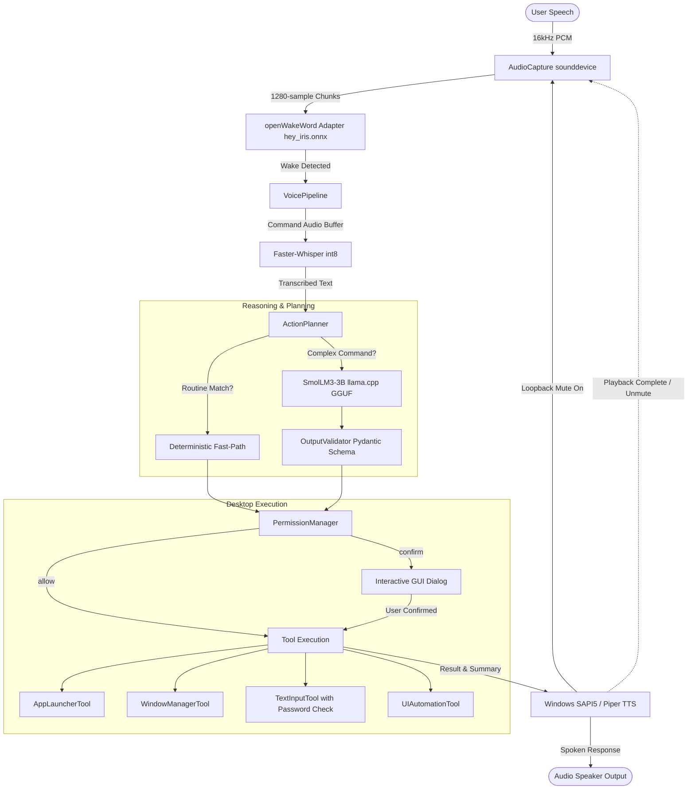

# Project IRIS — Native Windows Desktop Voice Agent with Local SmolLM3-3B Brain

[](https://microsoft.com/windows)
[](https://python.org)
[-FFD21E?logo=huggingface&logoColor=black)](https://huggingface.co/HuggingFaceTB/SmolLM-3B-Instruct)
[-00C853)](file:///c:/Users/bavik/OneDrive/Desktop/Web-IRIS/models/wakeword/hey_iris.onnx)
[-blueviolet)](https://github.com/SYSTRAN/faster-whisper)
[](file:///c:/Users/bavik/OneDrive/Desktop/Web-IRIS/tests)
[](#privacy--security-model)

**Project IRIS** is a full-featured, system-wide, background voice assistant for Windows built completely with **100% local, offline AI**. It requires zero cloud API keys, zero external subscriptions, and transmits zero data over the internet.

Reasoning is powered by a locally executed **SmolLM3-3B** model (`smol-Q4_K_M.gguf`, ~1.78 GB), wake-word detection uses a custom-trained **"Hey Iris"** ONNX model with openWakeWord preprocessors, speech recognition runs via **Faster-Whisper (int8)**, voice output utilizes **Windows SAPI5 / Piper TTS**, and Windows desktop control is achieved through safe native Win32 and UI Automation APIs.

---

## Table of Contents

- [Key Highlights](#key-highlights)
- [System Requirements](#system-requirements)
- [Quick Start Guide](#quick-start-guide)
  - [Step 1: Clone Repository](#step-1-clone-the-repository)
  - [Step 2: Virtual Environment Setup](#step-2-set-up-virtual-environment)
  - [Step 3: Install Dependencies](#step-3-install-dependencies)
  - [Step 4: Model Setup (SmolLM3-3B & Wake-Word)](#step-4-model-setup)
  - [Step 5: Run Automated Tests](#step-5-run-automated-test-suite)
- [How to Start & Run Project IRIS](#how-to-start--run-project-iris)
  - [Option A: Interactive GUI Dashboard](#option-a-interactive-gui-dashboard-recommended)
  - [Option B: One-Click Windows Batch Launcher](#option-b-one-click-windows-batch-launcher)
  - [Option C: IPC Quick Opener](#option-c-ipc-quick-opener)
- [Voice Interaction & Spoken Commands](#voice-interaction--spoken-commands)
- [Subsystem Architecture & Flow](#subsystem-architecture--flow)
- [Deterministic Fast-Path vs. SmolLM3-3B LLM](#deterministic-fast-path-vs-smollm3-3b-llm)
- [Privacy & Security Model](#privacy--security-model)
- [Desktop UI & System Tray Integration](#desktop-ui--system-tray-integration)
- [IPC Socket Control](#ipc-socket-control)
- [Configuration Reference](#configuration-reference)
- [Project Directory Structure](#project-directory-structure)
- [Troubleshooting & FAQs](#troubleshooting--faqs)

---

## Key Highlights

- 🧠 **100% Local SmolLM3-3B Brain**: Runs locally on CPU or GPU via `llama-cpp-python` with quantized `Q4_K_M` GGUF. Consumes ~1.9 GB RAM, leaving ample headroom for Windows and desktop apps.
- 🎯 **Dedicated "Hey Iris" Wake-Word**: Real-time acoustic wake-word engine running ONNX Runtime computational graphs with 80-bin mel-spectrogram preprocessors and 96-dimensional embeddings.
- 🎙️ **Acoustic Loopback Protection**: Microphone capture is muted automatically during text-to-speech output so IRIS never accidentally triggers off its own voice.
- ⚡ **Sub-10ms Deterministic Fast-Path**: Routine commands (launching notepad, switching windows, volume adjustment, greetings) execute immediately without waiting for LLM generation.
- 🛡️ **Zero-Trust Tool Permissions**: Language model is an untrusted planner constrained to a verified JSON tool-calling schema. Sensitive commands (e.g., text submission) require explicit authorization.
- 🔒 **Password Field Detection**: Windows UI Automation inspects focused elements before typing to actively block typing into password or credential fields.
- 🎨 **PySide6 Cyberpunk Dashboard & System Tray**: Modern dark UI with live VU audio metering, interactive model test sandbox, 6 configuration pages, and seamless minimize-to-system-tray background operation.
- 🔌 **IPC JSON-RPC Socket Service**: Local socket server (`127.0.0.1:19842`) enables third-party scripts, batch files, or hotkeys to summon the UI or trigger commands.

---

## System Requirements

| Component | Minimum Requirement | Recommended |
|---|---|---|
| **Operating System** | Windows 10 (64-bit, build 19041+) | Windows 11 (64-bit) |
| **Python** | Python 3.11 or 3.12 | Python 3.12 (64-bit) |
| **CPU** | 4 Cores (with AVX2 support) | 6+ Cores (Intel Core i5/i7/Ultra or AMD Ryzen 5/7) |
| **RAM** | 8 GB System Memory | 16 GB System Memory |
| **Disk Space** | ~4 GB free disk space | SSD with 5+ GB free |
| **Audio** | Working microphone & speakers | Standard headset or built-in array |
| **GPU (Optional)** | None (runs CPU AVX2) | NVIDIA CUDA GPU or Intel Iris Xe |

---

## Quick Start Guide

Follow these steps to set up and run Project IRIS from scratch.

### Step 1: Clone the Repository

Open PowerShell or Windows Terminal:

```powershell
git clone https://github.com/bavikadichanakya/WebIRIS.git
cd WebIRIS
```

### Step 2: Set Up Virtual Environment

You can use either [uv](https://github.com/astral-sh/uv) (ultra-fast) or standard Python `venv`:

**Using `uv` (Recommended):**
```powershell
# Create Python 3.12 virtual environment
uv venv --python 3.12 .venv

# Activate environment
.\.venv\Scripts\activate
```

**Using standard Python:**
```powershell
python -m venv .venv
.\.venv\Scripts\activate
```

### Step 3: Install Dependencies

Install the pinned dependencies from [`requirements.txt`](file:///c:/Users/bavik/OneDrive/Desktop/Web-IRIS/requirements.txt). For `llama-cpp-python`, specify the prebuilt wheel index for CPU/AVX2 acceleration:

```powershell
pip install -r requirements.txt --extra-index-url https://abetlen.github.io/llama-cpp-python/whl/cpu
```

> [!TIP]
> If using `uv`, you can run:
> ```powershell
> uv pip install -r requirements.txt --extra-index-url https://abetlen.github.io/llama-cpp-python/whl/cpu
> ```

### Step 4: Model Setup

Project IRIS relies on two model components:

1. **Wake-Word Models (Included in Repo)**:
   - Located in [`models/wakeword/`](file:///c:/Users/bavik/OneDrive/Desktop/Web-IRIS/models/wakeword/):
     - `hey_iris.onnx` (Trained openWakeWord model, ~200 KB)
     - `melspectrogram.onnx` (Acoustic preprocessor, ~1.08 MB)
     - `embedding_model.onnx` (Acoustic embeddings, ~1.32 MB)
   - These are already bundled and ready to use immediately.

2. **SmolLM3-3B GGUF Model (~1.78 GB)**:
   - Due to GitHub's 100 MB file limit, the large model weight (`smol-Q4_K_M.gguf`) is downloaded separately.
   - Run the included automated CLI downloader:
     ```powershell
     python scripts/download_model.py
     ```
   - *Alternatively*: Launch IRIS directly, and the built-in **First-Run Setup Wizard** will offer to download and verify the model automatically.

### Step 5: Run Automated Test Suite

Before running the assistant, verify that your environment, state machine, JSON validator, audio pipeline, and Win32 automation tools pass all tests:

```powershell
pytest -v
```

All **42 automated unit & integration tests** should pass.

---

## How to Start & Run Project IRIS

### Option A: Interactive GUI Dashboard (Recommended)

Launch the full desktop voice agent with the PySide6 control dashboard:

```powershell
python run_iris.py
```

This starts:
1. The background voice pipeline (microphone capture & wake-word detection).
2. The local IPC server (`127.0.0.1:19842`).
3. The dark cyberpunk desktop window showing live metrics, audio levels, and model status.
4. The Windows System Tray icon.

### Option B: One-Click Windows Batch Launcher

Double-click [`open_iris.bat`](file:///c:/Users/bavik/OneDrive/Desktop/Web-IRIS/open_iris.bat) in the project directory, or run from PowerShell:

```powershell
.\open_iris.bat
```

This batch script automatically launches the Python virtual environment and opens the IRIS dashboard.

### Option C: IPC Quick Opener

If IRIS is already running in the background minimized to the System Tray, run:

```powershell
python open_dashboard.py
```

This sends a JSON-RPC command via localhost socket to instantly un-minimize and focus the IRIS dashboard without spawning duplicate processes.

---

## Voice Interaction & Spoken Commands

Project IRIS operates through an intuitive conversation loop:

1. **Activate the Wake-Word**:
   Say clearly:
   > **"Hey Iris"**
2. **Visual & Auditory Feedback**:
   - The UI state indicator changes from **`LISTENING`** (cyan) to **`WAKE_DETECTED`** (gold).
   - Audio capture buffers your following speech.
3. **Speak Your Command**:
   Examples of supported requests:
   - **Launch Applications**:
     - *"Open Notepad"*
     - *"Launch Calculator"*
     - *"Open Google Chrome"*
     - *"Open Windows Terminal"*
   - **Window & Task Management**:
     - *"Switch to Chrome"*
     - *"Focus Calculator"*
     - *"Show my open windows"*
   - **Dictation & Safe Text Input**:
     - *"Type Hello, this is an automated test"*
     - *"Type meeting notes into the document"*
   - **General Assistance & Reasoning**:
     - *"What can you do?"*
     - *"What is the capital of France?"*
     - *"Help me write a Python function to sort a list"*
4. **Execution & Speech**:
   - Faster-Whisper transcribes the audio.
   - The Action Planner routes to the deterministic fast-path or queries SmolLM3-3B.
   - The requested tool executes with security checks.
   - Windows SAPI5 speaks the response while the microphone is muted.
   - After speaking ends, IRIS re-arms to `LISTENING`.

---

## Subsystem Architecture & Flow



### State Machine Lifecycle

```
[ IDLE ] 
    │
    ▼ (Start)
[ LISTENING ] ◄────────────────────────────────────────┐
    │                                                   │
    ▼ ("Hey Iris" detected)                             │
[ WAKE_DETECTED ]                                       │
    │                                                   │
    ▼ (User speaks command + silence VAD)               │
[ TRANSCRIBING ]                                        │
    │                                                   │
    ▼ (Text available)                                  │
[ THINKING ]                                            │
    │                                                   │
    ▼ (Plan validated)                                  │
[ EXECUTING ]                                           │
    │                                                   │
    ▼ (Action completed)                                │
[ SPEAKING ] ───────────────────────────────────────────┘
               (Audio playback finished; mic un-muted)
```

---

## Deterministic Fast-Path vs. SmolLM3-3B LLM

Project IRIS uses a hybrid dual-engine architecture:

```
User Query: "Open Notepad"
    │
    ├─► Deterministic Fast-Path Regex Match ──► [Instant execution in <5ms, no LLM required]
    │
User Query: "Summarize this idea and type three bullet points into my notes"
    │
    └─► PromptBuilder (System Catalog) ──► SmolLM3-3B Reasoning ──► Validated JSON Action
```

### 1. Deterministic Fast-Path
For common desktop tasks, running an LLM creates unnecessary latency. IRIS includes pattern-matched fast-paths for:
- App launching: *"open / launch / start [app]"*
- Window focusing: *"switch to / focus [window]"*
- Direct queries: *"what can you do / help"*
- Pleasantries: *"hello / hi / good morning"*

### 2. Local SmolLM3-3B Brain
When requests require multi-step reasoning, contextual synthesis, or open-ended formatting, the query is routed to `SmolLM3-3B` with a structured tool catalog:
- Returns strictly validated JSON conforming to the `ActionPlan` Pydantic model:
  ```json
  {
    "thought": "User wants to draft an email greeting",
    "tool_name": "type_text",
    "arguments": {
      "text": "Dear team,\n\nHere is the project update:\n"
    },
    "spoken_response": "Typing your message now."
  }
  ```
- **Output Validator**: Automatically catches markdown code blocks, extracts JSON objects, validates tool names, and fixes minor syntax anomalies before execution.

---

## Privacy & Security Model

Project IRIS is engineered with defense-in-depth:

1. **Untrusted Planner Paradigm**:
   - The LLM is never given raw shell access or `eval()` privileges.
   - It can only invoke pre-registered, sandboxed tools in [`iris/tools/registry.py`](file:///c:/Users/bavik/OneDrive/Desktop/Web-IRIS/iris/tools/registry.py).

2. **Password Field Protection**:
   - Before typing via `TextInputTool`, Windows UI Automation queries the focused element (`GetFocusedControl()`).
   - If the element has `IsPassword == True` or control properties denote a password or PIN field, keystroke injection is **immediately aborted**.

3. **Per-Tool Permission Policies**:
   - Configurable in [`config/iris_config.json`](file:///c:/Users/bavik/OneDrive/Desktop/Web-IRIS/config/iris_config.json):
     - `"allow"`: Automatically executes without prompts (e.g., read element, open app).
     - `"confirm"`: Pops up an interactive confirmation dialog (e.g., `submit_text` which presses Enter).
     - `"deny"`: Disables the tool entirely.

4. **Zero Cloud Leaks & Log Redaction**:
   - All models (ONNX, Whisper, SmolLM3-3B) run locally.
   - The memory logging buffer automatically sanitizes common credential patterns.

---

## Desktop UI & System Tray Integration

The desktop interface is built using **PySide6** and features a dark theme (`iris/ui/theme.py`):

- **Dashboard Tab**: Real-time agent status badge, active window indicator, live VU microphone level bar, and recent activity log.
- **SmolLM3-3B Brain Tab**: Backend selector (llama.cpp vs. Transformers), temperature, context length, thread controls, and an interactive prompt sandbox.
- **Voice & Audio Tab**: Audio input device selection, wake-word sensitivity threshold, cooldown timers, Whisper compute type, and TTS voice selection.
- **Automation Tools Tab**: Allowlisted application table (add/remove apps), keystroke delay settings, and per-tool permission overrides.
- **Setup & Models Tab**: Health inspector for all components, SHA-256 verifier, and model download progress.
- **Diagnostic Logs Tab**: Live rotating log viewer with log-level filtering and clear/export buttons.

### System Tray Behavior
- Clicking the window close button (`X`) **minimizes IRIS to the Windows System Tray** so voice recognition remains active in the background.
- Tray context menu allows:
  - **Open Dashboard**: Restores the window.
  - **Pause / Resume Listening**: Temporarily mutes wake-word listening.
  - **Exit Project IRIS**: Cleanly shuts down background threads and releases audio/socket resources.

---

## IPC Socket Control

Project IRIS runs a lightweight localhost TCP socket server:
- **Host**: `127.0.0.1`
- **Port**: `19842`

External scripts, AutoHotkey, or Windows shortcuts can interact with IRIS using line-delimited JSON messages:

```json
{"msg_type": "request", "command": "show_dashboard", "payload": {}}
```

Available commands:
- `show_dashboard`: Brings the settings window to the foreground.
- `hide_dashboard`: Minimizes the window to the tray.
- `pause_listening`: Pauses voice ingestion.
- `resume_listening`: Resumes voice ingestion.
- `get_status`: Returns current state machine state and health.

---

## Configuration Reference

Settings are stored in [`config/iris_config.json`](file:///c:/Users/bavik/OneDrive/Desktop/Web-IRIS/config/iris_config.json) and validated using Pydantic:

```json
{
  "version": "1.0.0",
  "model": {
    "model_path": "models/smollm3/smol-Q4_K_M.gguf",
    "backend": "auto",
    "context_length": 2048,
    "max_output_tokens": 512,
    "temperature": 0.2,
    "n_threads": 4,
    "n_gpu_layers": 0
  },
  "wake_word": {
    "model_path": "models/wakeword/hey_iris.onnx",
    "threshold": 0.5,
    "cooldown_seconds": 1.5,
    "enabled": true
  },
  "stt": {
    "backend": "faster_whisper",
    "model_size": "tiny.en",
    "device": "cpu",
    "compute_type": "int8",
    "silence_threshold_seconds": 1.2
  },
  "tts": {
    "backend": "sapi5",
    "rate": 180,
    "volume": 1.0
  },
  "automation": {
    "allowed_applications": {
      "notepad": "notepad.exe",
      "calculator": "calc.exe",
      "chrome": "chrome.exe",
      "terminal": "wt.exe"
    },
    "typing_delay_ms": 15,
    "block_password_fields": true
  },
  "security": {
    "require_confirmation_for_submission": true,
    "tool_permissions": {
      "open_application": "allow",
      "focus_window": "allow",
      "type_text": "allow",
      "submit_text": "confirm"
    }
  }
}
```

---

## Project Directory Structure

```
Web-IRIS/
├── config/
│   └── iris_config.json        # Main configuration file
├── docs/
│   └── architecture.md         # Detailed architectural specs
├── iris/
│   ├── app/
│   │   ├── main.py             # Application entrypoint & Qt event loop
│   │   └── bootstrap.py        # Service container & dependency injection
│   ├── brain/
│   │   ├── action_planner.py   # Hybrid planner (Fast-Path + SmolLM3)
│   │   ├── inference_backend.py# llama.cpp & Transformers abstractions
│   │   ├── model_manager.py    # Threaded model execution & health check
│   │   ├── output_validator.py # JSON extraction & Pydantic validation
│   │   └── prompt_builder.py   # Tool catalog prompt formatting
│   ├── core/
│   │   ├── config.py           # Pydantic configuration schemas
│   │   ├── event_bus.py        # Thread-safe pub/sub event bus
│   │   ├── logging_setup.py    # Rotating file & memory logging
│   │   └── state_machine.py    # Runtime state machine
│   ├── ipc/
│   │   ├── client.py           # JSON-RPC client
│   │   ├── protocol.py         # Socket message framing
│   │   └── server.py           # Local socket server (port 19842)
│   ├── security/
│   │   ├── confirmations.py    # GUI confirmation dialog handler
│   │   └── permissions.py      # Tool permission policies
│   ├── setup/
│   │   ├── downloader.py       # Chunked resumable HTTP downloader
│   │   ├── environment.py      # System inspector (Python, audio, GPU)
│   │   ├── manifest.py         # Component manifests & URLs
│   │   └── verifier.py         # Checksum & integrity verifier
│   ├── tools/
│   │   ├── app_launcher.py     # Allowlisted application launcher
│   │   ├── registry.py         # Central tool registry
│   │   ├── schemas.py          # Tool parameter schemas
│   │   ├── text_input.py       # Safe typing & password field blocking
│   │   ├── ui_automation.py    # UI inspection via Windows UIA
│   │   └── window_manager.py   # Native window enumeration & focus
│   ├── ui/
│   │   ├── main_window.py      # PySide6 desktop window
│   │   ├── settings_pages.py   # 6 settings & diagnostics pages
│   │   ├── setup_wizard.py     # First-run setup wizard dialog
│   │   ├── theme.py            # Dark stylesheet
│   │   └── tray.py             # Windows System Tray integration
│   └── voice/
│       ├── audio_capture.py    # sounddevice stream & RMS metering
│       ├── stt_adapter.py      # Faster-Whisper adapter
│       ├── tts_adapter.py      # Windows SAPI5 / Piper TTS
│       ├── voice_pipeline.py   # Voice loop with loopback protection
│       └── wake_word_adapter.py# openWakeWord ONNX runner
├── models/
│   ├── wakeword/
│   │   ├── hey_iris.onnx       # Trained wake-word model
│   │   ├── melspectrogram.onnx # Mel-spectrogram ONNX
│   │   └── embedding_model.onnx# Audio embedding ONNX
│   └── smollm3/
│       └── smol-Q4_K_M.gguf    # SmolLM3-3B GGUF (downloaded via script)
├── scripts/
│   └── download_model.py       # CLI model downloader
├── tests/                      # 42 unit & integration tests
├── .gitignore                  # Git ignore rules
├── open_dashboard.py           # IPC foreground bringer
├── open_iris.bat               # Windows one-click batch launcher
├── requirements.txt            # Python dependencies
├── run_iris.py                 # Primary launcher script
└── README.md                   # This documentation
```

---

## Troubleshooting & FAQs

### 1. The assistant doesn't react to "Hey Iris"
- **Check Microphone Selection**: In the **Voice & Audio** tab, ensure your active microphone is selected as the default recording device.
- **Check Microphone Levels**: Watch the VU level bar on the **Dashboard** tab. Speak to ensure the meter responds to your voice.
- **Sensitivity Threshold**: Try lowering the wake-word threshold from `0.5` to `0.35` in settings.

### 2. `llama-cpp-python` installation issues
- Ensure you used the prebuilt CPU wheel:
  ```powershell
  pip install llama-cpp-python --extra-index-url https://abetlen.github.io/llama-cpp-python/whl/cpu
  ```
- If your system has an NVIDIA GPU with CUDA installed, you can build with CUDA acceleration using `CMAKE_ARGS="-DGGML_CUDA=on" pip install llama-cpp-python`.

### 3. Faster-Whisper download errors
- Faster-Whisper downloads `tiny.en` (~75 MB) to your local cache (`~/.cache/huggingface/hub`) on first run. Ensure you have an active internet connection when running for the first time.

### 4. Text typing into password fields is blocked
- This is an intentional security feature. IRIS inspects the active control type using Windows UI Automation. To disable this protection (not recommended), set `"block_password_fields": false` in [`config/iris_config.json`](file:///c:/Users/bavik/OneDrive/Desktop/Web-IRIS/config/iris_config.json).

### 5. How to close the app completely
- Closing the window with `X` minimizes to the System Tray.
- To exit completely: Right-click the IRIS icon in the Windows notification area (bottom-right of your taskbar) and select **Exit Project IRIS**.

---

## Contributing & License

Project IRIS is an open-source, local AI desktop initiative. Contributions, bug reports, and suggestions are welcome via [GitHub Issues](https://github.com/bavikadichanakya/WebIRIS/issues) and [Pull Requests](https://github.com/bavikadichanakya/WebIRIS/pulls).
